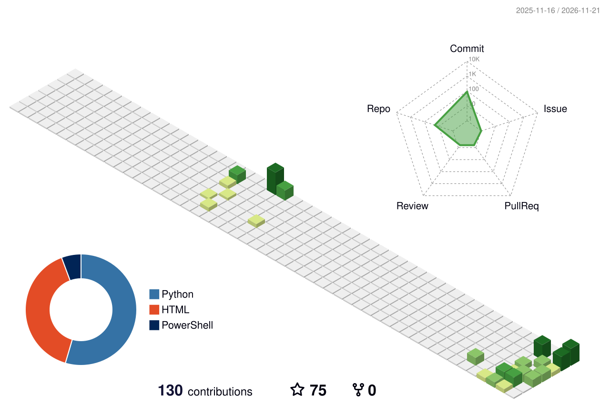

<!-- Header -->
<h1><strong align="left">After watching this where are you going? Bingo?</strong></h1>


<p align="center">
  
</p>

<p align="center">
  <a href="https://my-website-three-mu-29.vercel.app/">
    
  </a>
</p>

<p align="center">
  <a href="https://my-website-three-mu-29.vercel.app/"></a>
  <a href="mailto:dhurjatisharma2010@gmail.com"></a>
  <a href="https://github.com/DHURJATI-JS?tab=followers"></a>
</p>

---

## 🧠 About me

```python
class Dhurjati:
    location   = "Panvel, India"
    builds     = "local-first AI products: the models run on my own GPUs and the data stays on the machine"
    focus      = ["backend engineering", "backend hardening", "stress & scrutiny testing", "systems thinking"]
    ai_stack   = ["Gemma 3", "llama.cpp", "vLLM", "Ollama", "pgvector RAG", "Claude API"]
    home_lab   = "two GPU PCs behind one OpenAI-compatible gateway with automatic failover"
    works_on   = ["Linux (Arch)", "macOS", "Windows", "Docker"]

    def how_i_work(self):
        return ("I use AI tools like ChatGPT and Claude to build faster. "
                "The thinking is mine: the ideas, finding and solving the problems, "
                "the backend hardening and the scrutiny testing.")
```

---

<!-- RESEARCH:START -->
<!-- RESEARCH:END -->

<!-- SPOTLIGHT:START -->
## 🔦 Spotlight

<sub>Refreshed every day from my portfolio site.</sub>

<table>
<tr>
<td width="50%" valign="top">
<h3>🆕 Latest work</h3>
<a href="https://github.com/DHURJATI-JS/deminic-agentic-ai"></a>
<h4><a href="https://github.com/DHURJATI-JS/deminic-agentic-ai">Deminic Agentic AI</a></h4>
Deminic: a private, self-hosted agentic AI for life, business &amp; code. Local Gemma/Qwen first, Claude/ChatGPT only when needed. FastAPI, pgvector, Redis, Docker. MIT, as-is.<br><br>
<sub>🕒 Updated 25 Nov 2026 · ⭐ 1</sub>
</td>
<td width="50%" valign="top">
<h3>🔥 Most popular</h3>
<a href="https://github.com/DHURJATI-JS/elvin-autonomous-coding-agent"></a>
<h4><a href="https://github.com/DHURJATI-JS/elvin-autonomous-coding-agent">Elvin</a></h4>
Elvin is a local-first autonomous coding agent designed to plan, write, test, and fix code.<br><br>
<sub>⭐ 9 stars · 🍴 1 fork</sub>
</td>
</tr>
</table>

---
<!-- SPOTLIGHT:END -->

## 🤖 AI projects

<!-- PROJECTS:START -->
### 🚀 Industry & startup

<table>
<tr>
<td width="50%" valign="top">
<h3><a href="https://github.com/DHURJATI-JS/deminic-agentic-ai">✨ Deminic Agentic AI</a></h3>
Deminic: a private, self-hosted agentic AI for life, business &amp; code. Local Gemma/Qwen first, Claude/ChatGPT only when needed. FastAPI, pgvector, Redis, Docker. MIT, as-is.<br><br>
   
</td>
<td width="50%" valign="top">
<h3><a href="https://github.com/DHURJATI-JS/elvin-autonomous-coding-agent">✨ Elvin</a></h3>
Elvin is a local-first autonomous coding agent designed to plan, write, test, and fix code.<br><br>
   
</td>
</tr>
<tr>
<td width="50%" valign="top">
<h3><a href="https://github.com/DHURJATI-JS/podcast-qa-studio">✨ Podcast Q&amp;A Studio</a></h3>
Podcast Q&amp;A Studio is an AI-powered tool designed to assist in podcast production. It helps users write, check, and time podcast questions, or provides mock interviews with coaching.<br><br>
   
</td>
<td width="50%" valign="top">
<h3><a href="https://github.com/DHURJATI-JS/ai-cost-estimator-from-drawings">📐 StartupOS</a></h3>
AI cost estimates from machine drawings, inside a self-hosted workspace for startups: bookings with WhatsApp reminders, inventory alerts and a client portal.<br><br>
    
</td>
</tr>
<tr>
<td width="50%" valign="top">
<h3><a href="https://github.com/DHURJATI-JS/agentic-world-simulator">🌍 Agentic World Simulator</a></h3>
Test a startup's strategy in a simulated world: agent-based consumers, companies and traders on a 3D globe, calibrated to live data, with Monte Carlo forecasts and daily AI insights.<br><br>
   
</td>
<td width="50%" valign="top">
<h3><a href="https://github.com/DHURJATI-JS/school-and-tutorials-management-MVP">🎓 ClassNest</a></h3>
School and tuition-centre management: live classes with recording, RAG-generated notes and tests, and an AI tutor that answers from paused video frames.<br><br>
   
</td>
</tr>
<tr>
<td width="50%" valign="top">
<h3><a href="https://github.com/DHURJATI-JS/vulnerability-detector">🛡️ Vulnerability Detector</a></h3>
Find vulnerable Python dependencies before they find you: real OSV.dev advisories, a local Gemma review with a Claude fallback, and every upgrade re-verified.<br><br>
   
</td>
<td width="50%" valign="top">
<h3><a href="https://github.com/DHURJATI-JS/cardvault">📇 CardVault</a></h3>
A local visiting-card scanner: OpenCV straightens the photo, Apple Vision reads it, Gemma pulls out the contact, and pgvector powers typo-tolerant search.<br><br>
   
</td>
</tr>
<tr>
<td width="50%" valign="top">
<h3><a href="https://github.com/DHURJATI-JS/miniytapp">🎬 YT Mini</a></h3>
AI video intelligence: summaries from key frames plus Whisper captions, streamed live over Socket.IO, rate-limited and CSRF-protected, and stress-tested with Locust.<br><br>
   
</td>
<td width="50%" valign="top">
<h3><a href="https://github.com/DHURJATI-JS/ai-server-v2">🖥️ AI Server v2</a></h3>
One OpenAI-compatible link for two GPU PCs with automatic failover. It asks for the other PC's IP at boot, starts everything at logon and is reachable through a Cloudflare tunnel. (<a href="https://github.com/DHURJATI-JS/Ai-server">v1</a>)<br><br>
   
</td>
</tr>
<tr>
<td width="50%" valign="top">
<h3><a href="https://github.com/DHURJATI-JS/my-website">✨ AI-curated portfolio</a></h3>
My portfolio site: an AI reads every README, sorts each project into social impact or industry, writes the summary, and keeps it all up to date automatically.<br><br>
   
</td>
</tr>
</table>

### 💚 Social impact

<table>
<tr>
<td width="33%" valign="top">
<h3><a href="https://github.com/DHURJATI-JS/satark-local-llm-scam-detector">💡 Satark</a></h3>
Satark is a local-first AI tool designed to detect scams in India. It analyzes messages, links, screenshots, and second-hand prices using Gemma 3, running entirely on the user&#x27;s hardware.<br><br>
   
</td>
<td width="33%" valign="top">
<h3><a href="https://github.com/DHURJATI-JS/kisansetu-farmers-webapp">💡 KisanSetu</a></h3>
KisanSetu is a web application designed to connect farm workers, owners, and buyers in India.<br><br>
   
</td>
<td width="33%" valign="top">
<h3><a href="https://github.com/DHURJATI-JS/critical-thinking-enhancer">💡 Critical Thinking Enhancer</a></h3>
Critical Thinking Enhancer: a local-first cognitive trainer for student developers, with a talking Socratic AI coach, Qwen-coder challenges and hidden-bug hunts in your own code.<br><br>
   
</td>
</tr>
<tr>
<td width="33%" valign="top">
<h3><a href="https://github.com/DHURJATI-JS/AuraMind">🧩 AuraMind</a></h3>
An AI companion for intrusive thoughts, OCD and anxiety: thought dissection, an ERP urge-delay coach and an encrypted thought journal.<br><br>
  
</td>
<td width="33%" valign="top">
<h3><a href="https://github.com/DHURJATI-JS/mindfulness">🌼 Mindy</a></h3>
A companion for people living with dementia: a friendly animated face, reminders, stories and games, face or fingerprint login, and caregiver alerts.<br><br>
  
</td>
<td width="33%" valign="top">
<h3><a href="https://github.com/DHURJATI-JS/ocr-alphabet-detection">🤟 Fingerspelling OCR</a></h3>
Webcam fingerspelling (ISL/ASL) and printed-letter OCR to text, with user-taught signs. <i>Still in development.</i><br><br>
  
</td>
</tr>
</table>
<!-- PROJECTS:END -->

<p align="center"><a href="https://github.com/DHURJATI-JS?tab=repositories"><b>See all repositories →</b></a></p>

---

## 🛠️ Tech stack

**Languages**


**Backend, data & web**


    

**AI & machine learning**

           

**Platforms, DevOps & tools**


  

<!-- STACK:START -->
**Also used in my projects**


<!-- STACK:END -->

---

## 📈 GitHub activity

<p align="center">
  
  
</p>

<p align="center">
  
</p>

### 🧊 My commits in 3D

<p align="center">
  <picture>
    <source media="(prefers-color-scheme: dark)" srcset="https://raw.githubusercontent.com/DHURJATI-JS/DHURJATI-JS/output/profile-3d-contrib/profile-night-rainbow.svg">
    <source media="(prefers-color-scheme: light)" srcset="https://raw.githubusercontent.com/DHURJATI-JS/DHURJATI-JS/output/profile-3d-contrib/profile-green-animate.svg">
    
  </picture>
</p>

### 🐍 Watch the snake eat my commits

<p align="center">
  <picture>
    <source media="(prefers-color-scheme: dark)" srcset="https://raw.githubusercontent.com/DHURJATI-JS/DHURJATI-JS/output/github-contribution-grid-snake-dark.svg">
    <source media="(prefers-color-scheme: light)" srcset="https://raw.githubusercontent.com/DHURJATI-JS/DHURJATI-JS/output/github-contribution-grid-snake.svg">
    
  </picture>
</p>

---

<p align="center"><sub>All my projects are student-built and shared as-is, with no warranty or liability. Most are MIT-licensed; see each repo's LICENSE.</sub></p>

<p align="center">
  <a href="https://my-website-three-mu-29.vercel.app/">🌐 Portfolio</a> ·
  <a href="mailto:dhurjatisharma2010@gmail.com">📫 Email</a> ·
  <a href="https://github.com/DHURJATI-JS?tab=repositories">📦 Repositories</a>
</p>

<p align="center">
  
</p>
